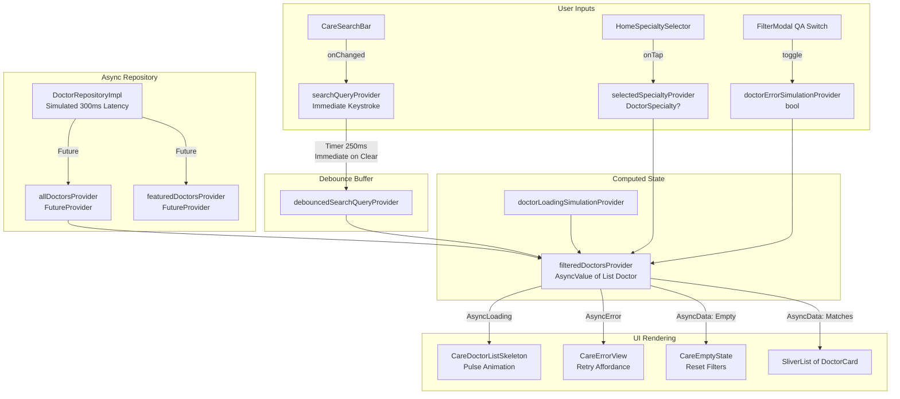

# CareConnect — Asynchronous Data Flow & State Lifecycle

**Date**: Tuesday, 17 November 2026 (Day 2 Deliverable)  
**System**: Reactive Asynchronous Architecture with Flutter Riverpod  

---

## 1. Overview & Data Pipeline

CareConnect's Day 2 architecture upgrades the doctor discovery experience from synchronous in-memory listing to a resilient asynchronous pipeline mimicking a production healthcare clinical directory. The pipeline gracefully accommodates network delays, search keystroke flooding, multi-attribute filtering, simulated outages, and user-initiated retries.



---

## 2. Asynchronous Repository Architecture

### Interface Segregation
The data layer maintains an abstract interface (`DoctorRepository`) in `lib/features/doctors/domain/doctor.dart`:
```dart
abstract class DoctorRepository {
  Future<List<Doctor>> getDoctors();
  Future<List<Doctor>> getFeaturedDoctors();
  Future<Doctor?> getDoctorById(String id);
  Future<List<Doctor>> searchDoctors({String? query, DoctorSpecialty? specialty});
  bool get isSimulatingError;
  void setSimulateError(bool simulate);
}
```

### Simulated Latency & Error Injection
`DoctorRepositoryImpl` simulates real-world networking via `Future.delayed(latency)`. The default latency is 300ms, ensuring responsive interactions while testing asynchronous lifecycle transitions.

```dart
class DoctorRepositoryImpl implements DoctorRepository {
  DoctorRepositoryImpl({
    this.latency = const Duration(milliseconds: 300),
    this.simulateError = false,
  });

  final Duration latency;
  bool simulateError;

  @override
  Future<List<Doctor>> getDoctors() async {
    if (latency > Duration.zero) await Future.delayed(latency);
    if (simulateError) {
      throw const DoctorRepositoryException(
        'Unable to reach CareConnect directory service. Network timeout or service unavailable.',
      );
    }
    return List.unmodifiable(_doctors);
  }
}
```

---

## 3. Reactive Search Debouncing

In mobile healthcare applications, rapid typing in doctor directory search fields can cause frame drops, network flooding, and out-of-order state overwrites.

### Implementation Strategy
CareConnect decouples the immediate UI text field input from the filtered list computation using two coordinated Riverpod notifiers:
1. **`searchQueryProvider` (`SearchQueryNotifier`)**: Updates synchronously on every keystroke (`onChanged`), driving the text field's clear button and active filter indicators without UI lag.
2. **`debouncedSearchQueryProvider` (`DebouncedSearchNotifier`)**:
   - Listens to `searchQueryProvider`.
   - On non-empty text entry, it cancels any existing `Timer` and arms a new `250ms` timer.
   - On query clear (`isEmpty`), it cancels the timer and propagates an empty string **immediately (0ms)**, ensuring instant feedback when the user taps "Clear".
   - Exposes a `flushImmediate(query)` method for deterministic unit test execution.

---

## 4. Multi-Attribute Filtering Logic

The `filteredDoctorsProvider` reactively combines all relevant state slices:
- Matches doctor name (case-insensitive substring).
- Matches doctor specialty display name.
- Matches doctor sub-specialty (e.g., "Interventional Cardiology", "Pediatric Dermatology").
- Matches clinic location / hospital name.
- Matches medical qualifications (e.g., "MD", "FACC", "FAAD").
- Filters by active specialty chip if one is selected.

---

## 5. Error Handling, Empty States & Retry Mechanism

CareConnect provides dedicated visual affordances for all asynchronous states:

1. **Loading State (`CareDoctorListSkeleton`)**:
   - Pulses with a subtle opacity curve ($0.3 \rightarrow 0.85$).
   - Matches the exact dimensions and card hierarchy of the production `DoctorCard`.
   - Bypasses continuous animation loops in widget test harnesses to ensure zero test timeouts.

2. **Error State (`CareErrorView`)**:
   - Catches `DoctorRepositoryException` or connection timeouts.
   - Displays a warm ivory card with warning accents, an informative clinical description, and an actionable "Retry" button.
   - On retry: invalidates `allDoctorsProvider` and `featuredDoctorsProvider`, clears simulated error flags, and triggers fresh data retrieval.

3. **Empty State (`CareEmptyState`)**:
   - Distinguishes between query-specific zero results ("No specialists match 'XYZ'") and specialty-specific zero results.
   - Provides a one-tap "Reset Filters" button that clears both search text and specialty filters.

