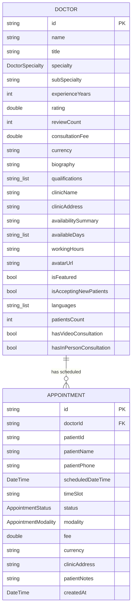

# CareConnect — Clinical Data Model Foundation

## 1. Overview & Architecture

CareConnect uses an immutable, feature-first domain model architecture designed in pure Dart. The models separate business entities from presentation state, UI rendering, and future persistence mechanisms.

---

## 2. Entity-Relationship Diagram

---

## 3. Model Specifications

### 3.1 `Doctor` Domain Model (`lib/features/doctors/domain/doctor.dart`)

The primary physician profile entity in CareConnect.

| Field | Type | Description |
|---|---|---|
| `id` | `String` | Stable unique identifier (e.g. `doc_alistair_vance`) |
| `name` | `String` | Full name of physician (e.g. `Dr. Alistair Vance`) |
| `title` | `String` | Professional post-nominal credentials (e.g. `MD, FACC`) |
| `specialty` | `DoctorSpecialty` | Clinical specialty enum (e.g. `cardiology`) |
| `subSpecialty` | `String` | Focused area of medical practice (e.g. `Interventional & Preventive Cardiology`) |
| `experienceYears` | `int` | Total years of licensed medical practice (e.g. `14`) |
| `rating` | `double` | Average patient satisfaction score from 1.0 to 5.0 (e.g. `4.9`) |
| `reviewCount` | `int` | Cumulative verified patient reviews (e.g. `312`) |
| `consultationFee` | `double` | Base out-of-pocket consultation fee (e.g. `140.0`) |
| `currency` | `String` | Currency symbol (defaults to `\$`) |
| `biography` | `String` | In-depth professional summary and clinical philosophy |
| `qualifications` | `List<String>` | Medical degrees, fellowships, and board certifications |
| `clinicName` | `String` | Primary outpatient medical center facility |
| `clinicAddress` | `String` | Physical building suite and street address |
| `availabilitySummary`| `String` | Immediate patient availability callout (e.g. `Next Available: Today, 2:30 PM`) |
| `availableDays` | `List<String>` | Weekly days on duty (e.g. `['Mon', 'Tue', 'Thu', 'Fri']`) |
| `workingHours` | `String` | Operational shift window (e.g. `08:30 AM - 04:30 PM`) |
| `avatarUrl` | `String?` | Remote portrait URL or fallback initials generator |
| `isFeatured` | `bool` | Flag for spotlight inclusion on the home dashboard |
| `isAcceptingNewPatients` | `bool` | Active patient panel intake status |
| `languages` | `List<String>` | Languages spoken during consultations |
| `patientsCount` | `int` | Number of treated patients |
| `hasVideoConsultation` | `bool` | Indicates telehealth consultation capability |
| `hasInPersonConsultation` | `bool` | Indicates on-site clinical consultation capability |

---

### 3.2 `DoctorSpecialty` Enum (`lib/features/doctors/domain/doctor_specialty.dart`)

Categorizes clinical specialties with system icons and patient-friendly descriptions:

1. **`generalMedicine`**: General & Family Medicine, Primary Care, Preventive Health (`Icons.health_and_safety_outlined`)
2. **`cardiology`**: Heart, Hypertension, Cardiovascular Wellness (`Icons.favorite_outline`)
3. **`pediatrics`**: Infant, Child & Adolescent Healthcare (`Icons.child_care_outlined`)
4. **`dermatology`**: Medical & Aesthetic Dermatology, Skin Pathology (`Icons.spa_outlined`)
5. **`neurology`**: Brain, Spine & Central Nervous System (`Icons.psychology_outlined`)
6. **`orthopedics`**: Bones, Joints, Arthroscopy & Sports Care (`Icons.accessibility_new_outlined`)
7. **`ophthalmology`**: Vision Care, Laser Surgery, Eye Pathology (`Icons.remove_red_eye_outlined`)
8. **`psychiatry`**: Mental Health, Behavioral Health & Counseling (`Icons.self_improvement_outlined`)

---

### 3.3 `Appointment` Foundation Model (`lib/features/doctors/domain/appointment.dart`)

The core appointment booking schema established in Day 1 to anchor Days 2–5.

| Field | Type | Description |
|---|---|---|
| `id` | `String` | Unique booking identifier (e.g. `apt_1001`) |
| `doctorId` | `String` | Foreign key referencing `Doctor.id` |
| `patientId` | `String` | Unique patient profile reference |
| `patientName` | `String` | Patient full legal name |
| `patientPhone` | `String` | Contact phone number for reminders |
| `scheduledDateTime`| `DateTime` | Calendar timestamp for scheduled appointment |
| `timeSlot` | `String` | Human-readable time slot (e.g. `02:30 PM`) |
| `status` | `AppointmentStatus` | Lifecycle status: `pending`, `confirmed`, `completed`, `cancelled`, `rescheduled` |
| `modality` | `AppointmentModality`| Consultation modality: `inPerson`, `video` |
| `fee` | `double` | Consultation charge recorded at booking time |
| `currency` | `String` | Currency symbol |
| `clinicAddress` | `String` | Facility or telehealth meeting URL |
| `patientNotes` | `String?` | Symptoms or consultation reason provided by patient |
| `createdAt` | `DateTime` | Record generation timestamp |

---

## 4. Fictional Dataset (`lib/features/doctors/data/mock_doctor_data.dart`)

The dataset contains 9 diverse fictional medical specialists across 8 departments:

1. **Dr. Alistair Vance, MD, FACC** — Cardiology (14 yrs, 4.9 rating, \$140)
2. **Dr. Elena Rostova, MD, FAAD** — Dermatology (11 yrs, 4.85 rating, \$125)
3. **Dr. Marcus Thorne, MD, FAAP** — Pediatrics (16 yrs, 4.96 rating, \$110)
4. **Dr. Sarah Jenkins, DO, MPH** — General Medicine (9 yrs, 4.88 rating, \$95)
5. **Dr. Tariq Al-Mansoor, MD, PhD** — Neurology (18 yrs, 4.93 rating, \$160)
6. **Dr. Maya Patel, MD, FAAOS** — Orthopedics (12 yrs, 4.82 rating, \$135)
7. **Dr. Julian Montgomery, MD, FACS** — Ophthalmology (15 yrs, 4.91 rating, \$130)
8. **Dr. Chloe Bennett, MD, FAPA** — Psychiatry (10 yrs, 4.94 rating, \$150)
9. **Dr. Arthur Pendelton, MD** — General Medicine / Geriatrics (22 yrs, 4.81 rating, \$100)

All clinical qualifications, residency programs, medical degrees, and facility addresses use consistent fictional entities centered around *CareConnect Metropolitan Health Center* (725 Harvard Medical Parkway, Boston, MA).

