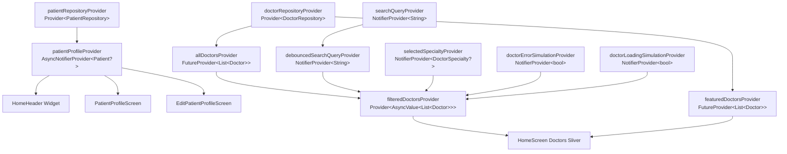

# CareConnect — Day 2 Architecture Specification

**Project**: CareConnect — Clinic Appointment Booking & Reminder Mobile App  
**Milestone**: Day 2 Architecture Specification  
**Date**: Tuesday, 17 November 2026  

---

## 1. Feature-First Layer Breakdown

CareConnect strictly follows a feature-first clean architecture separating presentation, domain, and data layers:

```
lib/
├── core/
│   ├── constants/
│   │   ├── app_assets.dart           # Fictional doctor portraits & placeholders
│   │   └── app_strings.dart          # Healthcare copy, headers, button labels
│   ├── router/
│   │   └── app_router.dart           # GoRouter config with named routes & transitions
│   ├── theme/
│   │   ├── app_colors.dart           # Deep navy, teal, warm ivory, soft mint palette
│   │   ├── app_elevation.dart        # Layered subtle drop shadows
│   │   ├── app_radii.dart            # Consistent card and chip corner radiuses
│   │   ├── app_spacing.dart          # 4pt/8pt grid layout spacing constants
│   │   ├── app_theme.dart            # Flutter ThemeData (light theme primary)
│   │   └── app_typography.dart       # Scalable typographic scale
│   └── widgets/
│       ├── care_badge.dart           # Status, rating, and filter tag badges
│       ├── care_button.dart          # Primary, secondary, outline, and subtle buttons
│       ├── care_card.dart            # Elevated healthcare surface container
│       ├── care_doctor_card_skeleton.dart # Shimmer pulse skeleton for doctor cards
│       ├── care_empty_state.dart     # Contextual zero-result presentation
│       ├── care_error_view.dart      # Resilient error view with retry action
│       ├── care_search_bar.dart      # Healthcare search bar with filter affordance
│       └── care_section_header.dart  # Uniform section titles with optional trailing action
├── features/
│   ├── booking/presentation/
│   │   └── booking_placeholder_sheet.dart # Day 1 appointment roadmap modal
│   ├── doctors/
│   │   ├── domain/
│   │   │   ├── doctor.dart           # Immutable Doctor entity & DoctorRepository contract
│   │   │   └── doctor_specialty.dart # Clinical specialty enum & taxonomy
│   │   ├── data/
│   │   │   └── doctor_repository.dart# DoctorRepositoryImpl with simulated delay & errors
│   │   └── presentation/
│   │       ├── controllers/
│   │       │   └── doctor_providers.dart # Riverpod directory, search & filter providers
│   │       ├── doctor_detail_screen.dart # Comprehensive clinical profile screen
│   │       └── widgets/              # DoctorCard, DoctorFeaturedCard, SpecialtyChip
│   ├── home/presentation/
│   │   ├── home_screen.dart          # Doctor discovery dashboard with sliver architecture
│   │   └── widgets/                  # HomeHeader, HomeHeroBanner, HomeSpecialtySelector
│   └── patient/
│       ├── domain/
│       │   └── patient.dart          # Immutable Patient entity with clinical preferences
│       ├── data/
│       │   └── patient_repository.dart # LocalPatientRepository with SharedPreferences persistence
│       └── presentation/
│           ├── controllers/
│           │   └── patient_provider.dart # patientProfileProvider AsyncNotifier
│           ├── patient_profile_screen.dart # Patient identity, MRN, allergies, preferences
│           └── edit_patient_profile_screen.dart # Form-validated demographic editor
└── main.dart                         # Entry point with ProviderScope & SharedPreferences init
```

---

## 2. Riverpod Provider Dependency Graph

CareConnect leverages Flutter Riverpod 2.6+ without code generation, maintaining transparent compile-time safety and decoupled testability.



---

## 3. GoRouter Route Hierarchy

Navigation uses declarative routing configured in `lib/core/router/app_router.dart`:

| Route Path | Name (`AppRouteNames`) | Screen Widget | Purpose & Deep Link Support |
| :--- | :--- | :--- | :--- |
| `/` | `home` | `HomeScreen` | Doctor discovery dashboard. Supports `?q=`, `?specialty=`, `?state=loading`, `?state=error`. |
| `/doctor/:id` | `doctorDetail` | `DoctorDetailScreen` | Clinical details, schedule, reviews, and appointment booking CTA for doctor `:id`. |
| `/profile` | `patientProfile` | `PatientProfileScreen` | Patient identity, MRN badge, contact info, clinical preferences, and local demo disclaimer. |
| `/profile/edit` | `editPatientProfile`| `EditPatientProfileScreen` | Validated demographic and clinical editor with save affordance. |

All routes utilize `AppPageTransitions.slideHorizontal` for a platform-native screen sliding animation on mobile devices.

---

## 4. Testability & Quality Architecture

The architecture was intentionally designed for comprehensive test automation:
- **50 Automated Tests**: 28 unit tests and 22 widget tests covering every model, repository, provider, screen, and user journey.
- **Zero Animation Lockup**: Animated skeletons (`CareDoctorCardSkeleton`) detect `WidgetsBinding` test mode and clamp controller progression, eliminating `pumpAndSettle` timeouts.
- **Deterministic Storage Mocking**: `SharedPreferences.setMockInitialValues` isolates each patient repository test without cross-test leakage.

