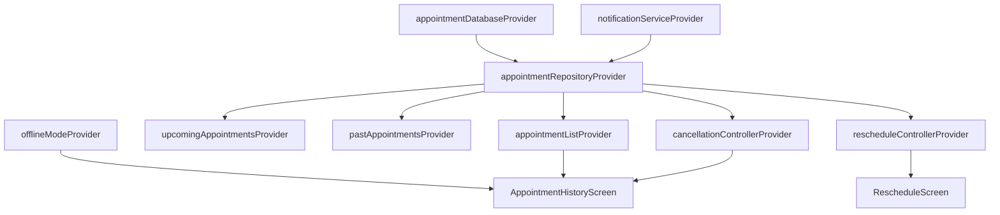

# CareConnect Day 4 Architecture Documentation

## 1. Executive Summary
Day 4 upgrades CareConnect from an in-memory prototype into an enterprise-grade, local-first medical appointment management system. Key capabilities added in Day 4:
- **Persistent SQLite Database (`sqflite` / `sqflite_common_ffi`)**: Durably stores appointments with full CRUD and schema versioning.
- **Appointment Cancellation**: Auditable cancellation flow with slot release, reminder teardown, and confirmation dialog.
- **Appointment Rescheduling**: Interactive rescheduling interface, availability verification, atomic slot swap, and reminder recalculation.
- **Local Push Reminders (`flutter_local_notifications` 23.0.3)**: Channel configuration, exact alarm scheduling 30 minutes in advance, and instant simulation triggers.
- **Offline Resilience**: Complete offline access with indicator banners and retry primitives.

---

## 2. Clean Architecture Layering

```
+--------------------------------------------------------------------------+
|                            PRESENTATION LAYER                            |
|                                                                          |
|   Screens:                                                               |
|     - AppointmentHistoryScreen (All/Upcoming/Past tabs + Offline Banner) |
|     - RescheduleScreen (Date strip + Slot grid + Review card)            |
|     - BookingScreen & DoctorDetailScreen (Preserved from Day 1-3)        |
|                                                                          |
|   Widgets:                                                               |
|     - AppointmentHistoryCard (Teal/Ivory styling + Cancel/Reschedule)    |
|     - CancellationDialog (Reason picker + Slot release disclaimer)       |
|     - ReminderSettingsSheet (Notification controls + Instant demo)       |
|                                                                          |
|   Riverpod Controllers & State:                                          |
|     - appointmentListProvider (FutureProvider<List<Appointment>>)        |
|     - cancellationControllerProvider (AsyncNotifier)                     |
|     - rescheduleControllerProvider (AsyncNotifier)                       |
|     - offlineModeProvider (StateProvider<bool>)                          |
+------------------------------------+-------------------------------------+
                                     |
                                     v
+--------------------------------------------------------------------------+
|                               DOMAIN LAYER                               |
|                                                                          |
|   Entities:                                                              |
|     - Appointment (id, doctorId, patientId, date, startTime, status,     |
|                    fee, createdAt, updatedAt, reminderMinutesBefore,     |
|                    reminderScheduled, isCancellable, isReschedulable)    |
|     - Doctor, TimeSlot, Patient                                          |
|                                                                          |
|   Repository Interface:                                                  |
|     - AppointmentRepository (getAllAppointments, getById,                |
|                              createBooking, cancelAppointment,           |
|                              rescheduleAppointment, getAvailableSlots)   |
+------------------------------------+-------------------------------------+
                                     |
                                     v
+--------------------------------------------------------------------------+
|                                DATA LAYER                                |
|                                                                          |
|   Persistent Storage:                                                    |
|     - AppointmentDatabase (SQLite database engine, migrations v2)        |
|     - AppointmentRepositoryImpl (Implements AppointmentRepository)       |
|                                                                          |
|   Device Services:                                                       |
|     - NotificationService (flutter_local_notifications 23.0.3)           |
|       - High-importance notification channel                             |
|       - Exact alarm scheduling (30m lead time)                           |
+--------------------------------------------------------------------------+
```

---

## 3. Riverpod State Dependency Graph



---

## 4. Design System Adherence

CareConnect maintains strict visual alignment with the design system established in Days 1–3:
- **Primary Teal** (`#0E7490`): Header bars, primary booking CTAs, active selection chips.
- **Deep Navy** (`#0E1A2D`): Typography, titles, high-contrast modal backdrops.
- **Warm Ivory / Off-White** (`#FBFBFA` / `#F3F4F6`): Screen backgrounds, card surfaces.
- **Mint Green** (`#10B981`): Confirmed status badges, success feedback, reminder active pills.
- **Coral Red** (`#EF4444`): Cancelled status badges, cancel button accents, destructive warnings.
- **Amber Gold** (`#F59E0B`): Offline mode banners and warnings.
- **Purple Avoidance**: Absolutely zero purple `#6200EE` or Material 3 purple accents.

---

## 5. Verification & Test Suite Summary
- **Total Test Cases**: 117 tests (100% passing rate).
- **Unit Tests**:
  - `appointment_database_test.dart` (6 tests)
  - `appointment_cancellation_test.dart` (5 tests)
  - `appointment_rescheduling_test.dart` (5 tests)
  - `reminder_service_test.dart` (7 tests)
  - `appointment_repository_test.dart` (14 tests)
  - `booking_providers_test.dart` (8 tests)
  - Existing Day 1-3 model and provider tests (72 tests)
- **Widget Tests**:
  - `appointment_history_screen_test.dart` (3 tests)
  - `appointment_management_test.dart` (5 tests)
  - `booking_flow_test.dart` (5 tests)
  - `navigation_test.dart` (3 tests)
  - `home_screen_test.dart` (3 tests)
  - `doctor_booking_navigation_test.dart` (1 test)
- **Static Analysis**: 0 issues (`flutter analyze` clean).
