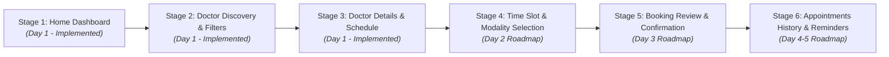

# CareConnect — Patient Journey & Service Architecture

## 1. Executive Summary

CareConnect is a clinic appointment booking and reminder mobile application engineered to provide patients with an intuitive, frictionless, and reassuring clinical discovery and care scheduling experience.

The product roadmap spans a 5-day phased lifecycle (16–20 November 2026). **Day 1 establishes the foundational 3 stages** (Home, Doctor Discovery/Search, and Doctor Profile Details), laying clean architectural and state abstractions for the subsequent booking, intake, reminders, and history stages.

---

## 2. End-to-End Patient Journey Architecture

---

## 3. Stage-by-Stage Breakdown

### Stage 1: Home Dashboard & Welcoming Environment *(Day 1 - Active)*
* **Objective:** Establish trust, reassure the patient, and surface clear entry points into clinical care.
* **Patient Touchpoints:**
  * **Welcoming Header:** Greets returning patient ("Maya Sterling"), provides access to patient medical profile summary, and displays real-time clinic notification alerts.
  * **Care Promotion Banner:** Explains available in-person and virtual telehealth options across departments with one-tap navigation to specialist listings.
  * **Real-Time Search Bar:** Instant predictive search across physician names, specialties, and clinics.
  * **Specialty Selector:** One-tap departmental chips (Cardiology, Dermatology, Pediatrics, General Medicine, Neurology, Orthopedics, Ophthalmology, Psychiatry).
  * **Featured Specialists Carousel:** Spotlight on top-rated physicians with credentials and immediate availability callouts.
  * **Available Doctors Directory:** Complete list of clinic physicians with transparent pricing, ratings, and experience.

### Stage 2: Discover & Search Doctors *(Day 1 - Active)*
* **Objective:** Enable swift, precise identification of the appropriate medical provider without cognitive overload.
* **Patient Touchpoints:**
  * Real-time query matching across name, specialty, clinical qualifications, and clinic locations.
  * Instant categorical filtering via horizontal specialty chips with single-tap toggle and clear filters affordances.
  * Responsive feedback with empty state illustrations and "Reset Filters" action when queries yield no matching results.
  * Accessible badges communicating verified ratings, years of clinical practice, and earliest appointment availability.

### Stage 3: Doctor Details & Clinical Profile *(Day 1 - Active)*
* **Objective:** Provide exhaustive clinical transparency so the patient can make an informed healthcare decision.
* **Patient Touchpoints:**
  * Physician portrait, board certifications, and clinical subspecialty focus.
  * Key performance metrics: Average patient rating, review count, years of medical practice, active patient count, and spoken languages.
  * Comprehensive narrative biography detailing care philosophy and clinical expertise.
  * Weekly facility hours and days of on-site/telehealth availability.
  * Verified medical degrees, residency hospitals, and board certifications.
  * Clinic facility details (address, building suite, and campus pavilion).
  * Transparent consultation fee with insurance note.
  * Bookmark/favorite toggle with instant feedback SnackBar.
  * Sticky bottom action bar with fee breakdown and primary **"Book Appointment"** call to action.
  * Tapping "Book Appointment" surfaces the **Booking Engine Roadmap Sheet** (clearly communicating the Day 2 booking milestone with full calendar slot selection).

---

## 4. Upcoming Journey Stages (Days 2–5 Roadmap)

### Stage 4: Select Appointment Slot & Modality *(Day 2 Scope)*
* Interactive horizontal calendar date strip (7–14 days rolling availability).
* Morning, Afternoon, and Evening time-slot grid dynamically populated from doctor schedule rules.
* Modality selector: **In-Person Visit** at Metropolitan Health Center vs. **Telehealth HD Video Consultation**.
* Patient visit reason and intake notes (e.g. routine checkup, symptom follow-up).

### Stage 5: Confirm Booking & Patient Intake *(Day 3 Scope)*
* Comprehensive pre-visit summary card: Doctor, specialty, date, time slot, location, consultation fee, and cancellation policy.
* Patient contact verification (phone number, emergency contact, insurance details).
* Appointment booking state machine transition: `pending` → `confirmed`.
* Confirmation modal with calendar sync prompt.

### Stage 6: Appointment History & Automated Reminders *(Days 4–5 Scope)*
* Dual-tab management: **Upcoming Appointments** vs. **Past Consultations**.
* Actionable appointment controls: Reschedule slot, cancel booking with confirmation dialog, download visit summary.
* Automated reminder notifications (24h before, 2h before consultation).
* Clinical follow-up notes and digital prescription preview.

---

## 5. Architectural Alignment & Clean Principles

| Layer | Responsibility | Day 1 Implementation |
|---|---|---|
| **Presentation** | UI widgets, custom themes, layout | `HomeScreen`, `DoctorDetailScreen`, reusable design system components |
| **Domain** | Business models, value objects, rules | `Doctor`, `DoctorSpecialty`, `Appointment` foundation |
| **Data** | Repositories, local persistence, mock feeds | `DoctorRepository`, `DoctorRepositoryImpl`, `MockDoctorData` |
| **State** | Reactive controllers and filters | Riverpod `NotifierProvider`s, `FutureProvider`s |
| **Routing** | Deep linking, page transitions | GoRouter with named parameters (`/doctor/:id`) and smooth slide transitions |

