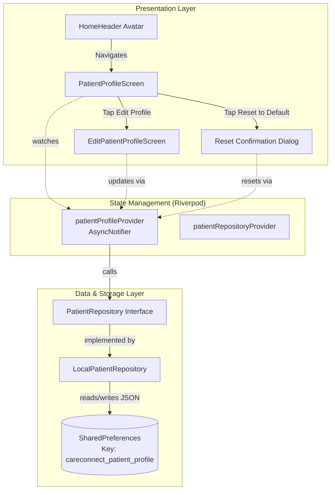

# CareConnect — Patient Profile & Local Identity Documentation

**Module**: `lib/features/patient`  
**Date**: Tuesday, 17 November 2026 (Day 2 Deliverable)  
**Status**: Production-Quality Mock Implementation  

---

## 1. Overview & Architecture

The **Patient Profile & Local Identity** module provides a cohesive, privacy-conscious local identity experience for the CareConnect mobile application. In accordance with Day 2 project constraints, CareConnect purposefully avoids external cloud authentication (such as Firebase Auth, Auth0, or AWS Cognito) and backend databases. Instead, it implements a clean repository pattern backed by local persistence (`shared_preferences`), simulating an authenticated, active clinical user session.



---

## 2. Patient Data Model

The `Patient` model (`lib/features/patient/domain/patient.dart`) is an immutable domain model representing a registered clinic patient.

### Schema Definition

| Property | Type | Nullable | Validation / Constraints | Description |
| :--- | :--- | :---: | :--- | :--- |
| `id` | `String` | No | UUID or unique string | Clinical unique identifier (e.g., `pat_sarah_jenkins_001`). |
| `medicalRecordNumber` | `String` | No | Format: `MRN-XXXXXX` | Clinical identifier shown on insurance and clinic badges. |
| `fullName` | `String` | No | Minimum 2 characters | Patient's legal full name. |
| `email` | `String` | No | Standard RFC 5322 regex | Primary notification and contact email. |
| `phone` | `String` | No | Minimum 7 digits, phone format | Contact telephone number for appointment reminders. |
| `dateOfBirth` | `DateTime?` | Yes | Valid past date | Date of birth for age calculation and clinical context. |
| `bloodGroup` | `String` | No | Standard ABO/Rh options | E.g., `A+`, `O+`, `B-`, `AB+`. Default: `'A+'`. |
| `allergies` | `List<String>` | No | List of strings | Known adverse reactions (e.g., `['Penicillin', 'Sulfa']`). |
| `emergencyContactName`| `String` | No | Minimum 2 characters | Primary contact in clinical emergencies. |
| `emergencyContactPhone`| `String` | No | Minimum 7 digits | Emergency phone number. |
| `preferredClinic` | `String` | No | Non-empty | Primary clinic location (e.g., `'CareConnect Metro Health'`). |

### Computed Properties
- **`initials`**: Extracts the uppercase initials from the patient's full name (e.g., `"Sarah Jenkins"` $\rightarrow$ `"SJ"`). Defaults to `"P"` if unresolvable.
- **`age`**: Evaluates elapsed full years from `dateOfBirth` against the current clock time.

### Demo Seed Identity
When the app starts for the first time or when the patient profile is reset, the repository automatically seeds the default demo patient:
```dart
Patient.defaultDemoPatient() = Patient(
  id: 'pat_sarah_jenkins_001',
  medicalRecordNumber: 'MRN-849204',
  fullName: 'Sarah Jenkins',
  email: 'sarah.jenkins@careconnect.demo',
  phone: '+1 (555) 234-5678',
  dateOfBirth: DateTime(1992, 6, 14),
  bloodGroup: 'A+',
  allergies: ['Penicillin', 'Latex'],
  emergencyContactName: 'Mark Jenkins (Spouse)',
  emergencyContactPhone: '+1 (555) 876-5432',
  preferredClinic: 'CareConnect Central Clinic',
);
```

---

## 3. Local Persistence Mechanism

### `LocalPatientRepository`
The repository (`lib/features/patient/data/patient_repository.dart`) persists the `Patient` model as a JSON string under the key `'careconnect_patient_profile'`.

1. **Auto-seeding on Empty Storage**:  
   If `sharedPreferences.getString(storageKey)` returns null, the repository stores `Patient.defaultDemoPatient()` immediately and returns it, guaranteeing the app never presents a broken or uninitialized user state.
2. **Defensive Parsing & Fallback**:  
   If stored data is corrupted or unparsable, the repository catches `FormatException`, logs a warning, and falls back gracefully to `Patient.defaultDemoPatient()`.
3. **Synchronous/Asynchronous Bridge**:  
   The repository interface returns `Future<Patient?>` and `Future<void>`, maintaining strict adherence to asynchronous architectural standards while leveraging disk-cached key-value storage.

---

## 4. Form Validation & UX Rules

The `EditPatientProfileScreen` enforces client-side validation before committing updates:

- **Full Name**: Required; must contain at least 2 non-whitespace characters.
- **Email Address**: Required; matches standard email regular expression (`^[\w\.-]+@([\w-]+\.)+[\w-]{2,4}$`).
- **Phone Number**: Required; must contain at least 7 digits (stripped of formatting).
- **Date of Birth**: Controlled via native date picker dialog; validated to ensure the date is in the past.
- **Blood Group**: Constrained selection via interactive dropdown picker (`A+`, `A-`, `B+`, `B-`, `AB+`, `AB-`, `O+`, `O-`).
- **Emergency Contact**: Required name (minimum 2 characters) and telephone number (minimum 7 digits).
- **Feedback**: On successful save, an animated SnackBar confirms the update and the screen pops back with refreshed state.

---

## 5. Privacy & Demo Identity Disclaimer

CareConnect is an educational, portfolio-grade healthcare demonstration:
- **No Cloud Synchronization**: All profile modifications reside exclusively within device-local storage (`SharedPreferences`).
- **HIPAA / GDPR Protection**: No protected health information (PHI) or genuine identity documents are collected or transmitted across the public internet.
- **Explicit In-App Disclaimer**: The `PatientProfileScreen` prominently displays a dismissible informational card stating:  
  > *"Local Demo Profile: This profile is stored locally on your device for demonstration purposes. No real patient data is transmitted or shared with external third-party services."*

